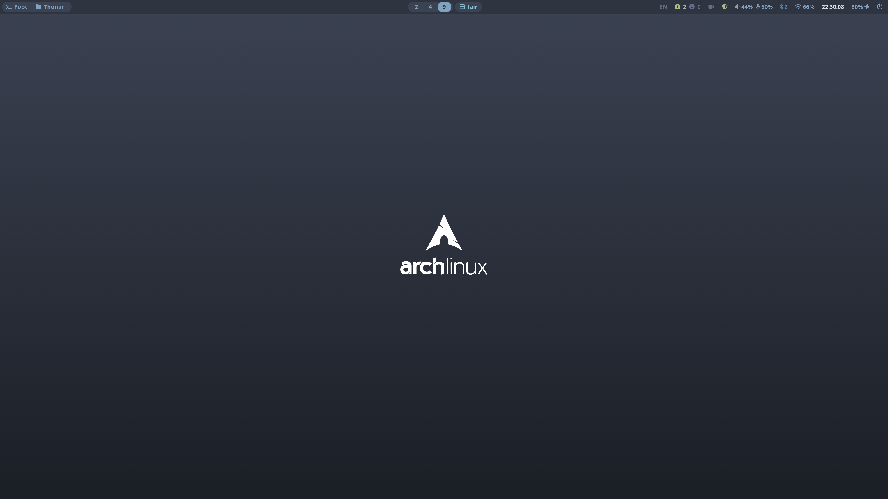
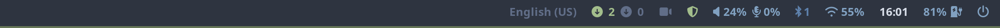
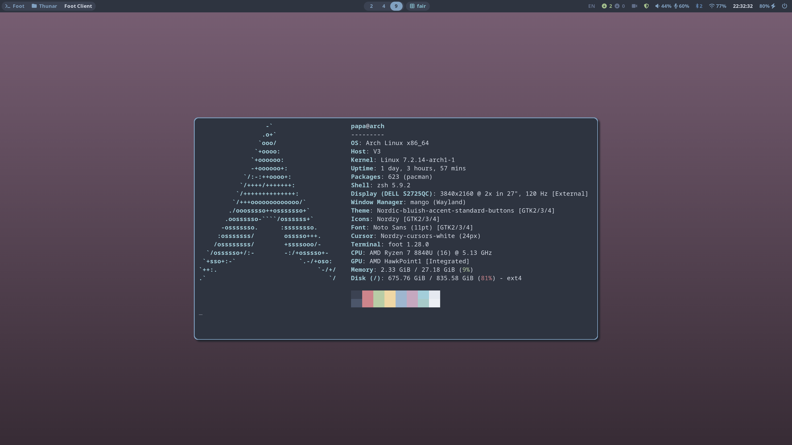
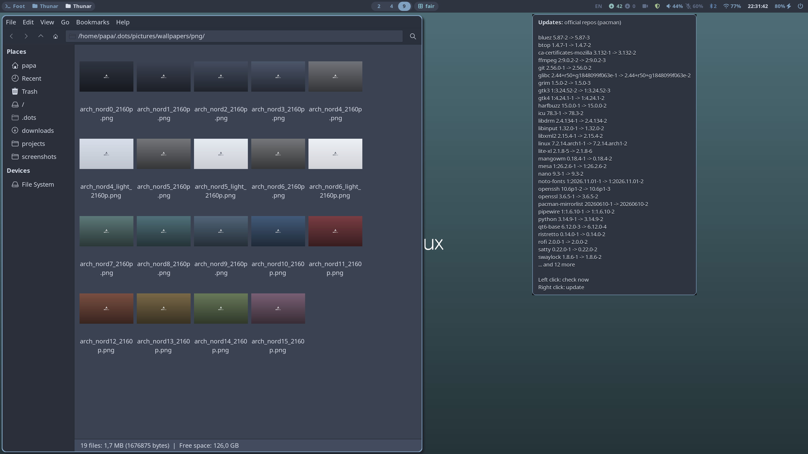
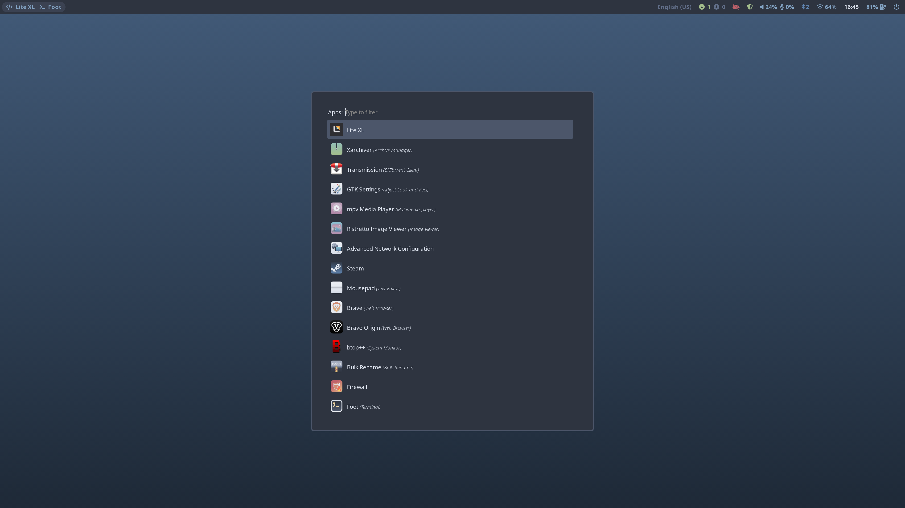
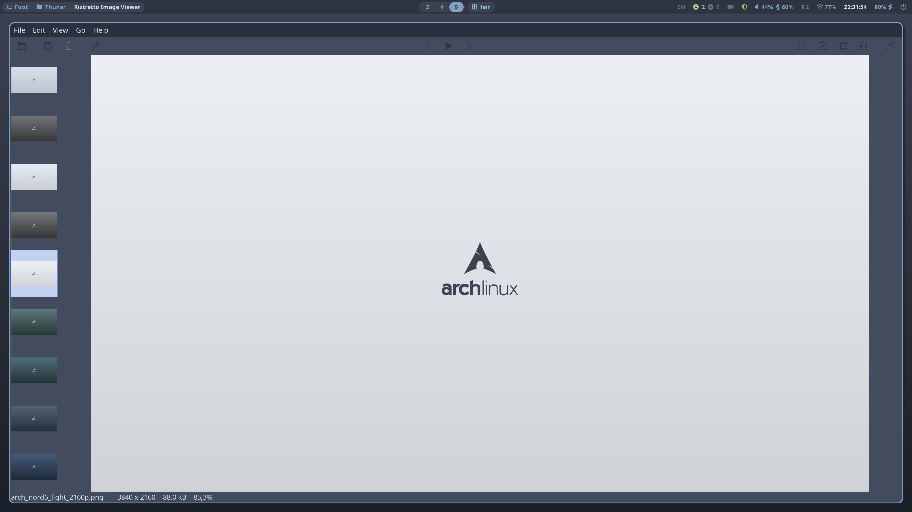
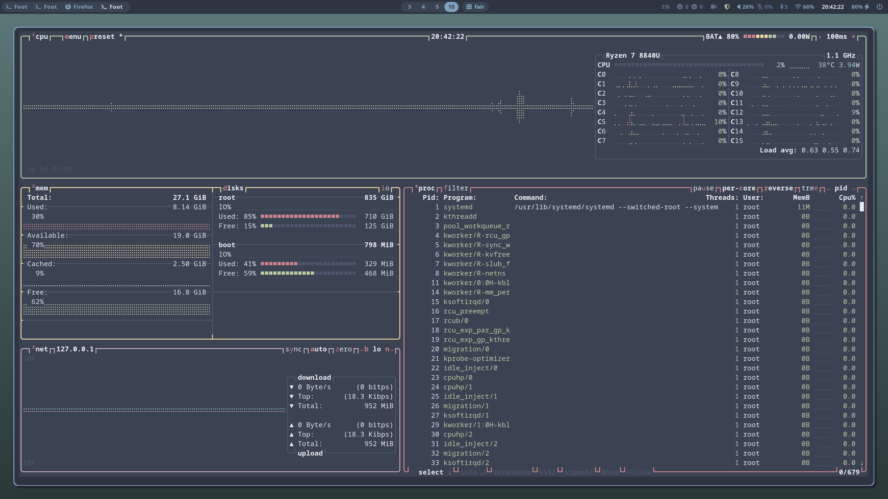
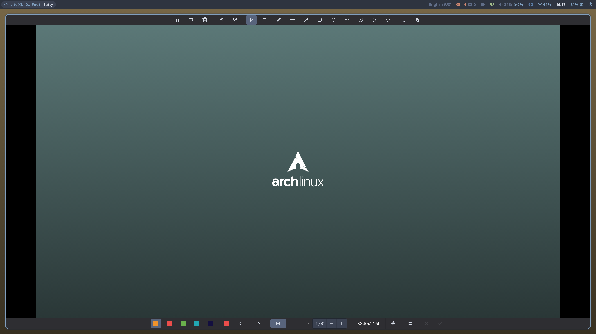
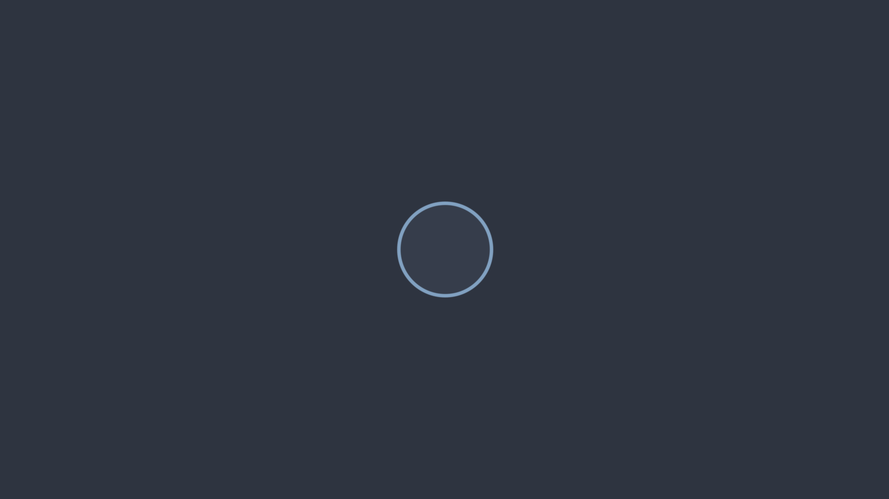
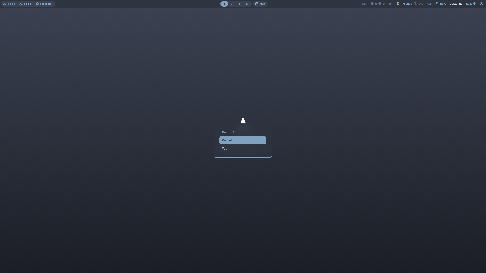

# arch-dots

The settings behind the desktop in the pictures, for Arch Linux. Programs keep their settings in files
whose names start with a dot (hidden files), hence "dotfiles". Here they are for:

- **mango**: arranges the windows (tiling: side by side, no overlapping) and holds the keyboard shortcuts
- **waybar**: the bar at the top, **rofi**: the app menu, **mako**: notifications
- **foot**: the terminal, **bash** the shell inside it (or **zsh**, with suggestions from your history)
- **swaylock**: the lock screen, **Thunar**: files, all in the [Nord](https://www.nordtheme.com/) colours

New to Arch? [arch-install](https://github.com/archlinux-fan/arch-install) installs Arch step by step and puts these files in place
(`desktop/70-dotfiles.sh`); guide: [archlinux-fan.github.io/arch-install](https://archlinux-fan.github.io/arch-install/).
Screenshots and wallpapers as a website: [archlinux-fan.github.io/arch-dots](https://archlinux-fan.github.io/arch-dots/)




waybar: keyboard layout, updates (official repos, AUR), webcam, firewall, sound, mic, Bluetooth, Wi-Fi, clock, battery, power.
Muted sound or mic turns grey, the update counters go green, orange, red; hover shows what each click does.

<!-- HTML, so both columns are half the width whatever the captions -->
<table>
<tr><td width="50%"></td><td width="50%"></td></tr>
<tr><td>fastfetch in foot, Nord palette</td><td>Thunar; mic muted, 42 updates listed on hover</td></tr>
<tr><td width="50%"></td><td width="50%"></td></tr>
<tr><td>rofi app launcher; webcam driver unloaded</td><td>Ristretto image viewer</td></tr>
<tr><td width="50%"></td><td width="50%"></td></tr>
<tr><td>btop; an AUR update</td><td>satty screenshot editor; sound muted</td></tr>
<tr><td width="50%"></td><td width="50%"></td></tr>
<tr><td>swaylock lock screen</td><td>hyprlock lock screen, if you install it instead</td></tr>
<tr><td width="50%"></td></tr>
<tr><td>Reboot / power off asks first (<code>power-confirm</code>); power icon on hover</td></tr>
</table>

Screenshots are 4K (3840x2160); click one for full size.

Wallpapers in all 16 Nord colours, and the script that makes them: [pictures/wallpapers](pictures/wallpapers/).

## Keys

Super is the Windows key. All of them, with comments: [.config/mango/keybindings.toml](.config/mango/keybindings.toml).

| Keys | What it does |
|---|---|
| Super+Return | terminal |
| Super+Space | app menu: type a few letters, Enter starts it |
| Super+B / T / E | browser / files / text editor |
| Super+Q | close the window |
| Super+F | full screen |
| Super+V | let the window float, or tile it again |
| Super+mouse drag | left button moves a window, right button resizes it |
| Super+arrows | go to the window on the left, right, above, below |
| Super+1 … 0 | show tag (workspace) 1 … 10 |
| Super+Ctrl+1 … 0 | move the window to tag 1 … 10 |
| Super+L | lock the screen |
| Super+U | install updates |
| Print / Shift+Print | screenshot of a region / of the frozen screen, to draw on in satty |
| Super+P | pick a colour anywhere on the screen |
| Super+Ctrl+Shift+R / P | reboot / power off (asks first) |
| Alt+Shift | next keyboard layout, if you set two (example in `general.toml`) |

## Install by hand

arch-install does this for you. The repo mirrors your home folder (`~`): `.config/mango/config.toml` here
belongs in `~/.config/mango/config.toml`. Copy its files into `~`, without the repo's own README, docs and screenshots:

```bash
git clone --depth 1 https://github.com/archlinux-fan/arch-dots /tmp/dots
cp -r /tmp/dots/.config /tmp/dots/.local /tmp/dots/pictures /tmp/dots/.bash_profile /tmp/dots/.zshenv ~
```

Want your changes in git? Link the files instead of copying them: [stow](https://www.gnu.org/software/stow/)
puts a link in `~` for every file, so a change in `~` is a change in the repo
(arch-install: `dots_link=y` in its settings file):

```bash
git clone https://github.com/archlinux-fan/arch-dots ~/.dots
stow --no-folding -d ~/.dots -t ~ .      # link
stow -D -d ~/.dots -t ~ .                # unlink
```

If a file already exists in `~`, stow stops and names it; move it away and run stow again.
`--no-folding` links single files, not whole folders, so other repos can add files to the same folders.

Personal files (ssh, git name and e-mail, monitors, keyboard layout) belong in a private repo linked the same way.
`~/.config/mango/local.toml` from there is read by `config.toml` after the shared settings.

zsh reads its settings in parts from `.config/zsh/conf.d` (history, keys, prompt, aliases for git, pacman, apt, docker ...).
`zsh_off` in `.config/zsh/.zshrc` leaves parts out (apt, docker and server by default);
`~/.config/zsh/local.zsh` from the private repo changes that for one computer, e.g. `zsh_off=(apt docker server welcome)`.

GTK apps on Wayland take the theme, icons, cursor and font from gsettings, not from `settings.ini`.
They are saved outside the repo; arch-install sets them, by hand it's once:

```bash
gsettings set org.gnome.desktop.interface gtk-theme 'Nordic-bluish-accent-standard-buttons'
gsettings set org.gnome.desktop.interface icon-theme 'Nordzy'
gsettings set org.gnome.desktop.interface cursor-theme 'Nordzy-cursors-white'
gsettings set org.gnome.desktop.interface cursor-size 24
gsettings set org.gnome.desktop.interface font-name 'Noto Sans 11'
gsettings set org.gnome.desktop.interface color-scheme 'prefer-dark'
```

## License

[MIT](LICENSE): use, change and share it as you like; keep the copyright notice.
Files from other projects keep their own license:

- [Nordic](https://github.com/EliverLara/Nordic) GTK theme, also in `.config/gtk-4.0`: GPL-3.0
- [Nordzy](https://github.com/alvatip/Nordzy-icon) icons and [cursors](https://github.com/alvatip/Nordzy-cursors): GPL-3.0
- Dracula and Nord styles in `.local/share/gtksourceview-4`: MIT, by their authors
- Lite XL colours, plugins and libraries in `.config/lite-xl`: the licenses of their projects, mostly MIT
- The Arch Linux logo in the wallpapers belongs to Arch Linux and follows its [trademark policy](https://terms.archlinux.org/docs/trademark-policy/).
