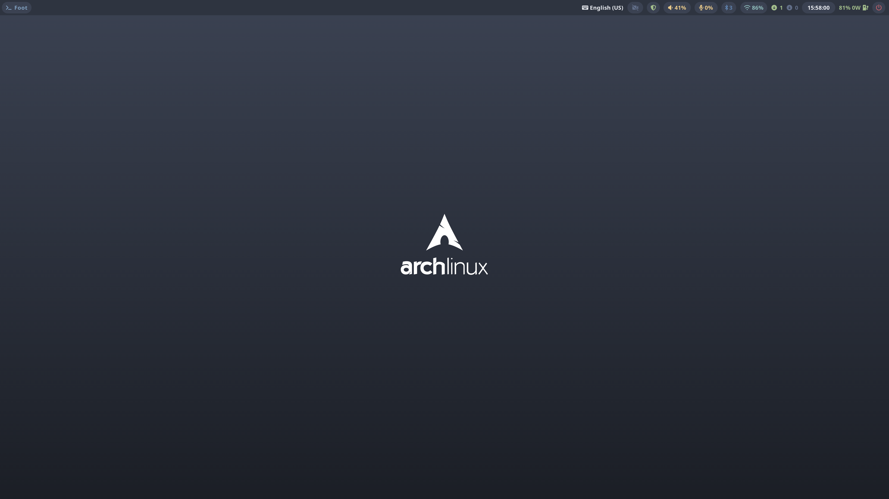
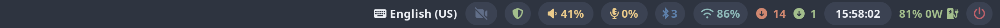
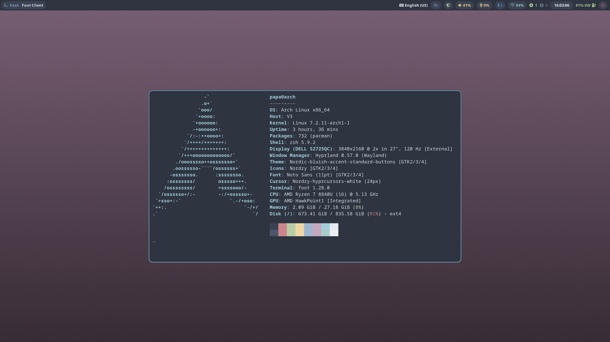
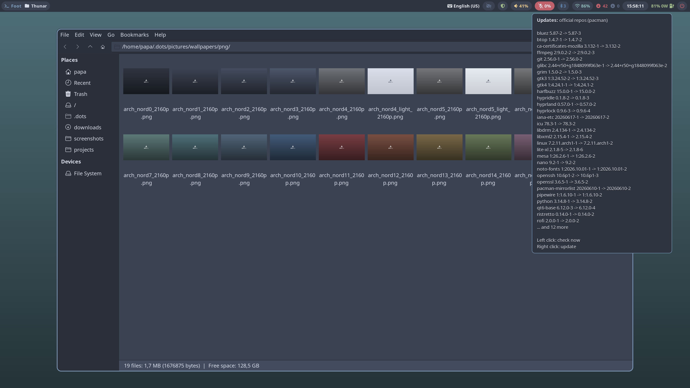
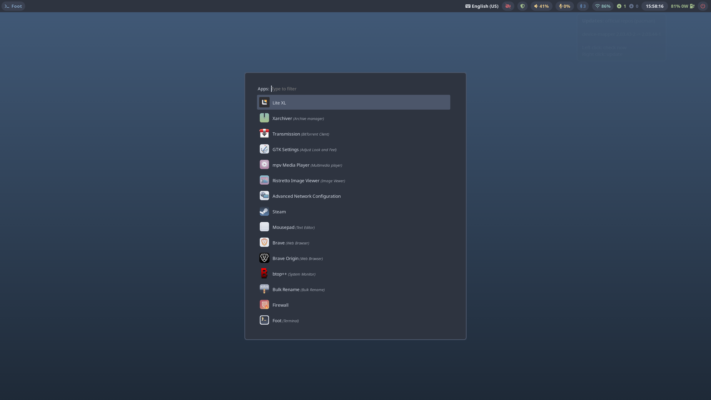
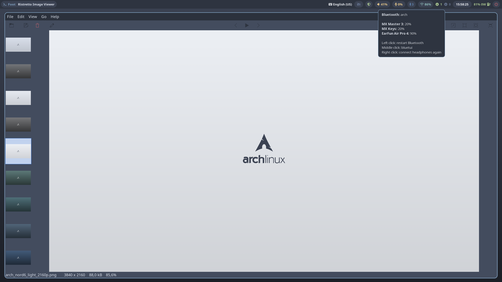
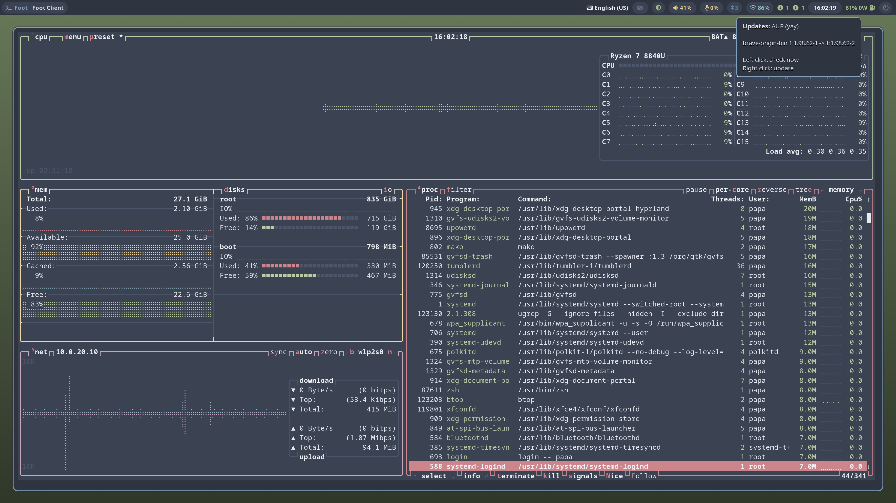
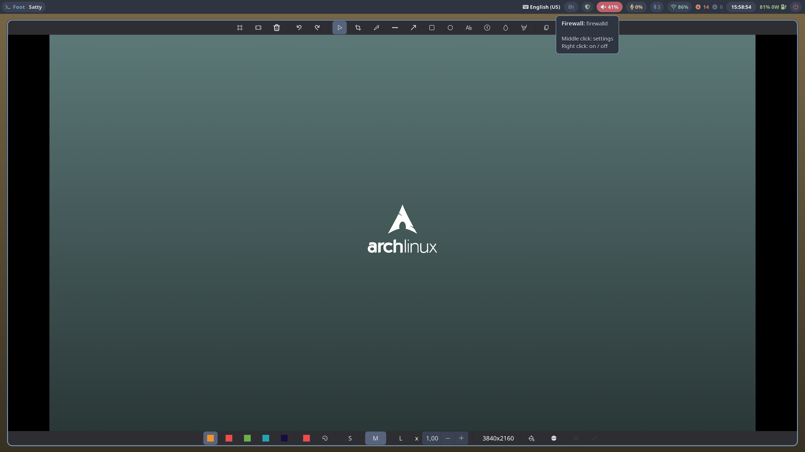
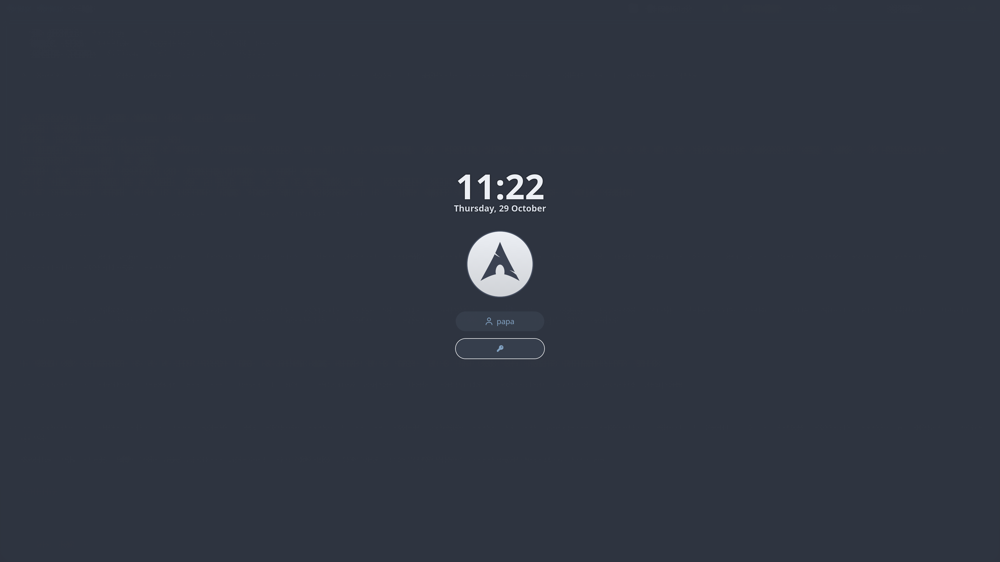
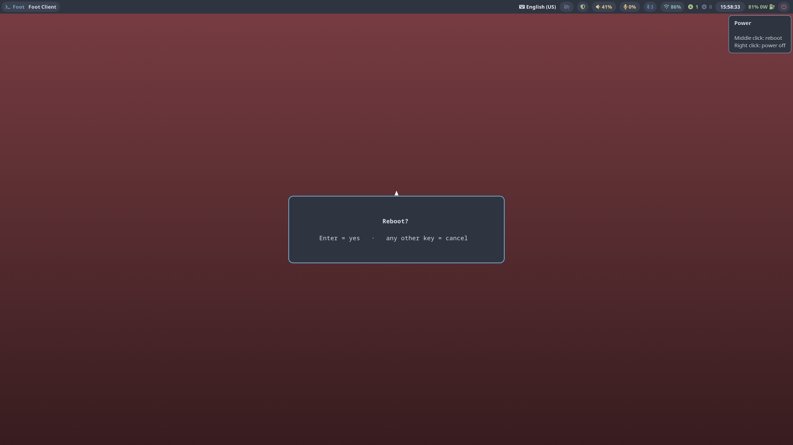

# arch-dots

Shared desktop setup (Hyprland, waybar, rofi, foot, zsh, Nord themes) for Arch Linux.
Installed by [arch-install](https://github.com/archlinux-fan/arch-install) (`desktop/70-dotfiles.sh`),
guide: [archlinux-fan.github.io/arch-install](https://archlinux-fan.github.io/arch-install/).
Screenshots and wallpapers as a website: [archlinux-fan.github.io/arch-dots](https://archlinux-fan.github.io/arch-dots/)




waybar: tray, keyboard layout, webcam, firewall, sound, mic, Bluetooth, Wi-Fi, updates (official repos, AUR), clock, battery, power.
Muted sound or mic turns red, the update counters go green, orange, red; hover shows what each click does.

| | |
|---|---|
|  |  |
| fastfetch in foot, Nord palette | Thunar; mic muted, 42 updates listed on hover |
|  |  |
| rofi app launcher; webcam driver unloaded | Ristretto image viewer; Bluetooth devices on hover |
|  |  |
| btop; an AUR update on hover | satty screenshot editor; sound muted, firewall on hover |
|  |  |
| hyprlock lock screen | Reboot / power off asks first (`power-confirm`); power icon on hover |

Screenshots are 4K (3840x2160); click one for full size.

Wallpapers in all 16 Nord colours, and the script that makes them: [pictures/wallpapers](pictures/wallpapers/).

The repo mirrors `~`. Link it, files only, so other repos can add files to the same folders:

```bash
stow --no-folding -d ~/.dots -t ~ .      # link
stow -D -d ~/.dots -t ~ .                # unlink
```

Personal files (ssh, git name and e-mail, monitors, keyboard) belong in a private repo linked the same way.

`~/.config/hypr/local.lua` from there is loaded last by `hyprland.lua`.

GTK 4 apps read the theme from gsettings: run `nwg-look` once and press Apply.
